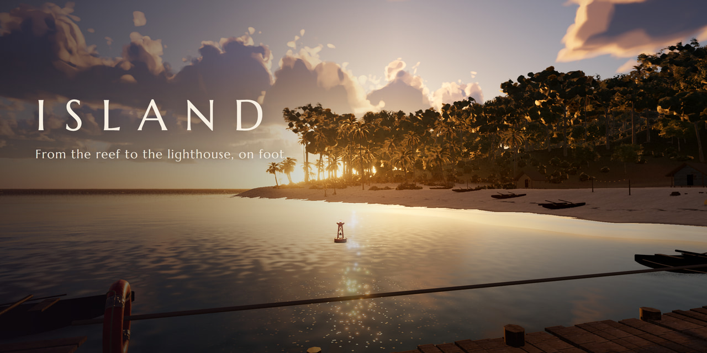

# Island

A realistic open-world tropical island in the browser, built in three.js with WebGPU. You wake on a beach at
sunrise, and everything you can see is reachable on foot: a dense rainforest, a 20 m waterfall with a pool you can
swim in, a fishing village of stilt huts with jetties and outrigger canoes, 50-85 m basalt sea cliffs, and a
lighthouse on the 214 m summit with a gallery that looks out over the whole island. There is nothing to win. The day
runs on its own over 30 minutes, from a slow sunrise through a long twilight to a moonlit night, rain squalls roll in
and clear, and the sound follows where you are: surf, wind, birds, rain, the falls, and footsteps that change with
the ground.



**Play it: https://starknightt.github.io/island/**

It wants a desktop GPU, a keyboard and a mouse (a gamepad works too); Chrome or Edge with WebGPU gives the full
picture. Browsers without WebGPU fall back to WebGL 2, with a still sea. It was built in Chrome on Windows and
measured on an RTX 4060 at 1920x1080. A first visit takes about 8 to 10 seconds behind the loading screen, and a
return visit about 7.

## Running it locally

```
git clone https://github.com/StarKnightt/island.git
cd island
pnpm install
pnpm dev        # http://127.0.0.1:5230/
pnpm build      # type-check, then a production build into dist/
pnpm preview    # serve dist/ on http://127.0.0.1:5231/ (what viewers get)
```

The only runtime dependency is `three` (r186.1); the game is TypeScript built with Vite, and `package.json` pins
pnpm 10. Both ports are fixed: if one is taken the server stops with an error instead of picking another. Every push
to `master` builds the site and deploys it to GitHub Pages through `.github/workflows/deploy.yml`.

## Controls

Click the scene once to capture the mouse.

| Input | Keyboard and mouse | Gamepad |
|---|---|---|
| Look | Move the mouse | Right stick |
| Move | W A S D | Left stick |
| Sprint / walk | Shift / Ctrl | B or L3 |
| Jump | Space | A |
| Photo mode | P or F: the HUD hides, W A S D and Q E fly the camera, Shift faster, `[` `]` change the lens, P exits | |
| Mute | M | |
| Debug overlay | F3 | |

Walk into water and he wades, then treads and swims once it is deep enough.

| URL option | Effect |
|---|---|
| `spot=waterfall` | Starts at `beach` (default), `jungle`, `waterfall`, `village`, `cliffs` or `lighthouse` |
| `tod=sunset` | Starts at `sunrise`, `morning`, `noon`, `afternoon`, `sunset`, `dusk`, `night` or an hour from 0 to 24 |
| `weather=rain` | `clear`, `rain` or `auto` (default: squalls come and go on their own) |
| `freeze=1` | Stops the clock |
| `daylen=60` | Length of a full day in minutes (30 by default) |
| `hud=0` | Hides the HUD |
| `quality=high` | `low`, `medium`, `high` or `ultra` (by default it picks one for your GPU) |
| `fps=0` | Removes the frame cap; a number sets a fixed rate |
| `webgl=1` | Forces the WebGL 2 backend |

The full list, the `window.__island` debug API and the test harness are in [TESTING.md](TESTING.md).

## Five camera spots for recording

Each one opens with a URL. In the browser console, `await __island.stage({ ... })` then puts the camera on the
authored shot for that place (the sunset variants turn toward the sun). Press P for photo mode to fine-tune the frame.

1. **Beach at sunrise:** the spawn, looking along the crescent beach to the sea and the palm islet as the sun comes up.
   `?spot=beach&tod=sunrise&weather=clear&hud=0`, then `__island.stage({ spot: 'beach', tod: 'sunrise', camera: 'shot', worldTime: null })`
2. **Lighthouse gallery at sunset:** from the rail across the canopy and the island's west coast, the sun going down over
   the sea at the right of the frame (crop the dark tip at the bottom-right corner with a longer lens, `]` in photo mode).
   `?spot=lighthouse&tod=sunset&weather=clear&hud=0`, then `__island.stage({ spot: 'lighthouse', tod: 'sunset', camera: 'shot', worldTime: null })`
3. **Waterfall at noon:** from the east bank across the plunge pool to the falls, with the sun high in the gorge.
   `?spot=waterfall&tod=noon&weather=clear&hud=0`, then `__island.stage({ spot: 'waterfall', tod: 'noon', camera: 'shot', worldTime: null })`
4. **Village at sunset:** from the end of the main jetty, past the moored canoes, to the western shore in the low sun.
   `?spot=village&tod=sunset&weather=clear&hud=0`, then `__island.stage({ spot: 'village', tod: 'sunset', camera: 'shot', worldTime: null })`
5. **Sea cliffs in the afternoon:** from a boat off the north coast along the 50-80 m cliffs, white water and backwash
   lace at their feet.
   `?spot=cliffs&tod=afternoon&weather=clear&hud=0`, then `__island.stage({ spot: 'cliffs', tod: 'afternoon', camera: 'shot', worldTime: null })`

Also worth a take: the beach at dusk (`tod: 'dusk'`), with the moon rising over the sea, and a squall walking in over
the village (`__island.timelapse({ squall: 6 })`).

For a finished recording, `pnpm record` renders the 30-second gameplay trailer: every frame is stepped by exactly
1/60 s and read back, so the result is a deterministic 60 fps video with its own sound mix. `scripts/record.ts`
defines the shots, and [TESTING.md](TESTING.md) explains the flags.

## What is in it

- **The island.** An authored island about 1.7 by 1.1 km: a crescent beach and a reef lagoon on the east, a palm
  islet and sea stacks offshore, rainforest hills, an 844 m river that drops 20 m over the falls into a closed plunge
  pool, the village cove, the north coast's basalt cliffs, and the summit cone with its lighthouse. Six trails
  connect them, and an outside spiral stair climbs to the lighthouse gallery.
- **The sea.** A three-cascade FFT ocean with breakers on the reef, swash up the sand that leaves a band of wet sand
  behind it, white water and backwash at the foot of the cliffs, and caustics in the lagoon.
- **The forest.** About 140,000 plants plus grass, in layers: palms, pandanus and beach scrub, the canopy, the
  mid-storey, the understory and the forest floor. They all move in the wind, and a far canopy shell carries the
  forest to the horizon.
- **The village.** Stilt huts with thatched roofs, jetties, outrigger canoes and nets, with chimes, chickens, creaking
  timber and gulls in the sound.
- **Day and weather.** A 30-minute day with the sun and moon placed for a tropical latitude, a gradual twilight, stars
  and a rising moon. Squalls bring rain, wet ground and puddles, splashes, and lightning with thunder delayed by its
  distance.
- **Sound.** Layered ambience by place, time and weather: waves by distance to the shore, surf, wind by height and
  exposure, birds by day, insects and frogs at night, rain, the falls and the stream as positional sources. Footsteps
  follow the surface underfoot (sand, wet sand, grass, leaves, rock, wood, the metal stair, shallow water), and the
  sound is muffled underwater.
- **On foot.** A third-person character who walks, sprints, jumps, wades and swims, with a straw hat and a beach
  shirt.
- **Photo mode and the loader.** P frees the camera with an adjustable lens. The loading screen is a title card over
  a still of the beach at sunrise rendered by the game, which dissolves into the live frame once the shaders are
  ready.

## How it works

### The island is baked

`src/world/layout.ts` describes the geography: a coastline spline that marks each stretch as beach, rock shelf or
sea cliff, the hills, the summit, the river, the pool, the village terrace and the trails. `pnpm gen:island` bakes it
in about 11 seconds, the same every time, into a 2048 x 2048 heightmap at 1 m with masks for sand, grass, dirt,
forest, rock, wet ground and water, and the distance to the shore. Along the way it runs hydraulic erosion, carves
the river so it always falls, closes the plunge pool's basin and grades the trails.

### Rendering

Three.js r186's `WebGPURenderer` with TSL node materials; the same renderer falls back to WebGL 2. The terrain is a
CDLOD quadtree with an eight-layer splat (dry and wet sand, jungle floor, grass, laterite, basalt, mossy rock, reef).
The sky follows Hillaire's 2020 model, with lookup tables re-rendered every frame and aerial perspective from them.
After cascaded sun shadows come ambient occlusion (GTAO), temporal anti-aliasing so the foliage doesn't shimmer,
bloom, AgX tone mapping, a small colour grade and auto-exposure from the time of day.

### The character

The player is Microsoft's Rocketbox avatar, converted in Blender, with the outfit repainted from the scan and a
procedural straw hat. Quaternius animation clips are retargeted onto its skeleton offline. The controller is
kinematic, over the heightfield and walkable platforms, with a slope limit and one shared stride for walking,
jogging and sprinting so blends never cross the feet.

### The frame cap

By default the game caps at the largest whole-number divisor of the screen's refresh rate that keeps at least 60
fps: 66.7 fps on a 200 Hz screen. If too many frames arrive a refresh late it steps down to the next divisor (50 fps
there) and tries the higher rate again after 8 seconds of headroom, so motion stays evenly paced.

[NOTES.md](NOTES.md) has the architecture, the asset pipeline and the decisions behind them.

## Performance

Measured in Chrome on an RTX 4060 at 1920x1080 on a 200 Hz screen, at all six named spots at sunrise, noon, sunset,
night and in the rain (30 combinations). With the default cap it held 66.5 to 66.7 fps everywhere, the cap falling back to 50 fps when needed.
Uncapped (`?fps=0`), the same views ran between 67.3 and 96.8 fps.

A first visit is playable in about 8 to 10 seconds, most of it building and compiling the shaders behind the loading
screen; a return visit takes about 7.

## Project structure

```
src/
  core/       renderer, post chain, frame cap and GPU timing, asset loading, URL options, quality presets
  world/      the authored layout, heightfield, terrain and its material, colliders, village, lighthouse
  water/      the FFT ocean, the river, plunge pool, waterfall and mist
  sky/        atmosphere, sky, clouds, stars and moon, time of day, weather
  veg/        procedural palms, trees, bushes and grass, the vegetation layers, the far canopy
  player/     input, the character and its controller, the camera rig
  audio/      Web Audio ambience, positional sources, footsteps, thunder
  ui/         loading screen, HUD, debug overlay
  debug/      the window.__island test API
scripts/      the test harness (shots, perf, clips, the trailer) and asset builders
tools/        offline bakers: the island, foliage atlases, animation retargeting, GLB optimizing, audio prep
public/world/ the baked island data
public/assets/ textures (KTX2), models (meshopt glTF) and sounds (Ogg)
```

`pnpm shots` takes screenshots at the named spots and times, `pnpm perf` records frame-time statistics, `pnpm clip`
records motion clips and `pnpm record` the trailer. [TESTING.md](TESTING.md) covers each one.

## Limitations

- **Browsers and hardware.** Built and measured in Chrome on Windows with an RTX 4060. Other browsers, GPUs and
  phones were not measured.
- **The WebGL 2 fallback** has a still sea, because the ocean simulation needs WebGPU compute.
- **The cliffs.** The white water stays on the surface, with no spray bursting up the wall, and the large lumps of
  rock read soft close up.
- **The waterfall.** The pool in front shows little foam and a reflected stripe of the falls, and the splash reads as
  soft puffs.
- **The jungle** uses one leaf-litter texture, and some sunlit trunks look warm orange in the afternoon.
- **The lighthouse view.** The nearest tree crowns under the gallery are still clumps of leaves; the authored shots
  keep them out of frame.
- **Rain** keeps the same brightness through a downpour.

## How it was built

It was built in Cursor by AI agents working in rounds: a builder implemented each round, a critic compared rendered
frames from fixed camera spots against reference photos, and the findings went into the next round. The user
steered it throughout.

## Licence and credits

The game's own code is MIT. See [LICENSE](LICENSE).

The third-party assets keep their own licences: the Poly Haven textures and models (CC0), the Microsoft Rocketbox
character (MIT), the Quaternius animations (CC0), the sound recordings, and the Marcellus font (SIL OFL 1.1).
[CREDITS.md](CREDITS.md) lists each one with its author, source and licence. Everything else, from the island's
geography to the shaders, the procedural plants, the buildings and the loading screen, was made for this project.
